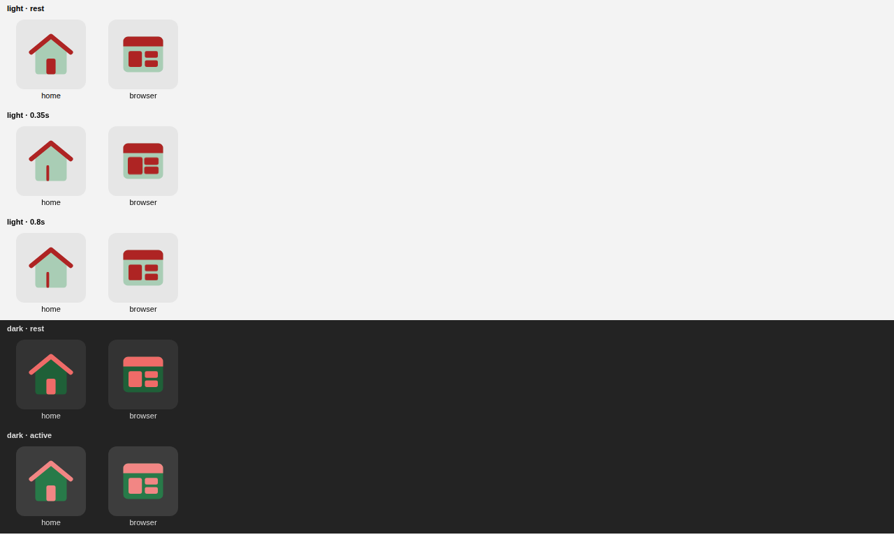

# Desk navigation

Ozone is reset to an empty module: no DocTypes, no website pages. What it ships is the desk
navigation that Frappe 16.51 builds from files:

| Surface | What it is | Where Ozone ships it |
|---|---|---|
| Apps screen | One tile per app at `/desk` | `add_to_apps_screen` in `hooks.py`; the tile is `public/icons/logo.svg` and opens `app_home`, `/desk/ozone` |
| Dock | The rail down the left of the desk | `ozone/dock/ozone/ozone.json`: one button, Ozone |
| Sidebar | The module's navigation | `ozone/ozone/sidebar/ozone/ozone.json`: Home |
| Workspace | The sidebar's landing page | `ozone/ozone/workspace/ozone/ozone.json`: empty |

When DocTypes are added to the Ozone module, list them in the sidebar (top links, or sections
with child links) and give the workspace a shortcut or card for each.

## Icons

`public/icons/module-icons.svg` holds Ozone's dual-tone icons, loaded by `app_include_icons`.
The two tones come from the logo: a pale green body from the Z and a red detail from the O.
Each icon animates while its dock button is hovered.

| Icon | Used for |
|---|---|
| browser | dock button, sidebar header, workspace |
| home | Home |



To add an icon, use the `frappe-desk-icons` Claude Code skill. Its source is in the naqel repo
at `docs/navigation/frappe-desk-icons/`, with the drawing rules, the motion patterns and a
checker. The other apps' sprites (hawya, naqel, butler, waqf) hold icons ready to reuse, such
as a document, stacked boxes and a gear.

```bash
python3 ~/.claude/skills/frappe-desk-icons/scripts/check_sprite.py ~/frappe-bench/apps/ozone
```
